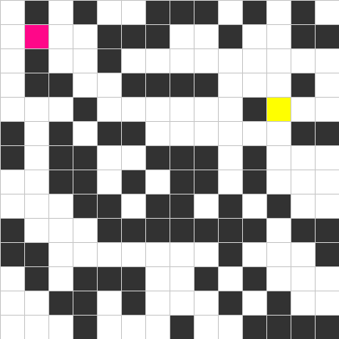
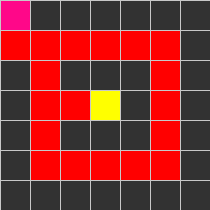
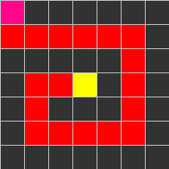

### Generates N x N matrix with obstacles

## finds the shortest possible path (on a grid, which does not have any traversal cost)
red and green colors mean the final route, red does not mean how the algorithm found the end

